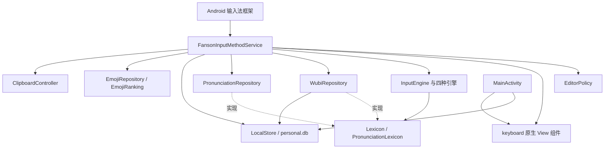

# 架构与运行时

基线与维护规则见 [技术文档入口](README.md)。本项目只有一个 Gradle 模块 `:app`，使用 Kotlin 与 Android 原生 View，按包划分职责。当前没有 Compose、AndroidX、协程、Room、DataStore、JNI 或完整 Rime 引擎；应用运行时数据均在本机。

## 组件与依赖

| 包 | 当前职责和关键文件 | 边界 |
| --- | --- | --- |
| `ime` | `FansonInputMethodService` 编排输入、线程、编辑器、面板及生命周期；`EditorPolicy` 判断字段 | 目前编排与大部分面板 View 构建仍集中在服务中 |
| `engine` | 五笔、英文、韩语；候选与结果契约；简繁、读音规则及语言枚举 | 纯 Kotlin 规则，不直接操作 View、Context 或 InputConnection |
| `data` | `LocalStore`、同文件内的 `WubiRepository`、`PronunciationRepository` | Android SQLite 与 assets 适配；实现引擎查询接口 |
| `keyboard` | `Ui`/`Palette`、候选布局与按钮、符号页、emoji 分类条、语言弹层、字根卡片 | 接收回调；宿主编辑仍由服务执行 |
| `emoji` | JSON 加载、分类搜索、常用排序 | 网格和搜索状态在服务内，不在仓库中 |
| `clipboard` | 系统剪贴板读取、清除、监听和快照类型 | 是否入历史由服务判断，落盘由 `LocalStore` 执行 |
| `settings` | `MainActivity`：启用引导、试打、设置、短语、许可 | 写本地设置；服务在输入生命周期读取，无实时订阅机制 |

目前没有独立 `privacy` 包。隐私策略分散于 `EditorPolicy`、服务的调用分支、`ClipboardController`、`LocalStore` 和 Manifest/备份 XML；修改时要联动检查。

## 初始化与降级

`onCreate()` 先创建 `LocalStore` 和 `ClipboardController`，绑定服务期监听并尝试捕获当前剪贴板；随后把以下资源准备按顺序提交到 worker：

1. `WubiRepository` 准备并打开五笔库。
2. 解析 `traditional.tsv` 创建 `TraditionalConverter`。
3. 准备 `PronunciationRepository`，创建 `WubiEngine`。
4. 额外尝试取得进程共享 WubiFrequencyStore，加载至多两万条个人词频并注入五笔引擎；此步骤失败单独回退固定排序，不阻止普通五笔输入。
5. 准备只读 `PinyinRepository` 和 `PinyinEngine`，复用简繁转换；随后读取 `english.txt` 创建英文词表与引擎。
6. 读取 `emoji.json` 创建 `EmojiRepository`。
7. 切回主线程，未销毁时设 `ready=true` 并重绘。

主要离线资源加载共用一段 `try/catch`；个人词频加载有独立异常回退。其他任一步失败会设 `loadFailed=true`；`enqueue()` 提示离线数据加载失败并拒绝输入任务，没有自动重试或单资源降级。加载中显示准备提示，地球不可用。`LocalStore` 创建与初次剪贴板捕获在上述 `try/catch` 外，不能把它们也描述成受同一失败兜底保护。

`onCreateInputView()` 创建根 View。资源可能晚于 View 就绪，`render()` 会检查根节点与 `Ui` 是否初始化。

## 线程归属

| 对象或操作 | 执行位置 | 原因与限制 |
| --- | --- | --- |
| `WubiEngine`、`PinyinEngine`、两种中文 SQL、读音查询及 LRU | worker 单线程 | 可变引擎和 SQLite 查询串行，避免主线程执行中文检索 |
| 简繁映射、英文词表、emoji JSON 初次加载 | worker | 统一初始化；成功后再允许输入 |
| `EnglishEngine` | worker 创建，之后主线程使用 | 英文预编辑状态与 composing 编辑同步，避免迟到光标回调打断新单词 |
| `EnglishCapitalization` / `EnglishEditorPosition` | 服务主线程持有 | 句首/持续大写状态和预测光标；宿主句首查询及实际编辑仍经服务现有链路，见 [英语维护说明](ENGLISH_INPUT.md) |
| `KoreanEngine` | 主线程 | 每次音节转换与宿主 composing 编辑同步 |
| View、UI 状态快照、`InputConnection` 操作 | 主线程 | worker 通过 `publishInput()` 投递结果，不直接接触宿主编辑器 |
| `WubiFrequency` | 共享同步模型；worker 查分/排序，主线程成功反馈，I/O 队列取快照 | 无 Android、SQL 或定时任务；只在短临界区访问内存 |
| `WubiFrequencyStore` 日常保存/显式清空 | 独立低优先级串行 I/O 队列 | 不占输入 worker；只持 Application；事务不持模型锁 |
| `LocalStore` | 多个调用位置；单实例方法 `@Synchronized` | 同一实例串行；Activity 和服务各自有实例，不是全局锁；emoji/剪贴板写入和部分设置读取仍在主线程 |
| emoji 搜索过滤、字形检测、候选 View 测量和重建 | 主线程 | 当前实现；后续性能优化应先测量 |

不要为了统一接口把英文/韩语任务直接搬进五笔 worker。它们的状态与 composing 回调的时序是现有正确性的一部分。也不要从主线程直接访问 `engine` 的可变状态，服务已有 `currentCode`、`candidateSnapshot`、`showingReadings` 作为显示快照。

## 生命周期和清理

| 回调或动作 | 当前处理 |
| --- | --- |
| `onStartInput()` | `invalidateSession()`；计算 `privateField/password`；通过 `LanguagePreferences` 读取上次主动语言（缺失用默认语言）并应用字段临时覆盖；数字类进入数字页；重置大小写并读取设置 |
| `onStartInputView()` | 重新读取设置并重绘 |
| `invalidateSession()` | 递增 `session`；关闭弹层；释放剪贴板预览；取消连删；清空候选、编码、读音及 emoji 搜索/分页状态；同步重置英文和韩语，排队重置五笔 |
| `onFinishInputView()` | 结束宿主 composing；失效会话；恢复主键盘并重绘 |
| `onFinishInput()` | 失效会话；清除隐私/密码标志 |
| 短按地球或菜单选择其他语言 | 先 `resolveThen()`，成功清码后失效会话，通过 `LanguagePreferences` 原子保存语言与非英语回切目标，再返回主键盘 |
| `onWindowHidden()` | 通知共享组件后台保存有变化的五笔词频；无变化不写，保存请求合并，无定时任务 |
| `onDestroy()` | 先标记销毁并使会话失效、停监听；调用父类后再排队关闭仓库和 store、关闭 worker、移除主线程回调 |

销毁顺序有实际约束：父类 `onDestroy()` 会触发结束输入回调，worker 要在这些回调之后关闭，不能提前 `shutdown()` 再让回调向其投递任务。服务的剪贴板监听持续到销毁，键盘或剪贴板面板隐藏本身不停止监听。

`traditional` 与 `spelling` 默认分别为 `false/true`，在当前服务对象内保留，不落盘；会话失效不重置它们。默认语言、常用语言与非英语回切目标经 `LanguagePreferences` 落盘，相关键通过 `LocalStore.putAll()` 在同一 SQLite 事务保存，表结构与数据库版本不变；字段自动覆盖不写入。大小写在新输入框重置，韩语一次 Shift 在当前字母输入后复原。

## 当前实现决策记录

| 当前选择 | 代码体现与维护影响 |
| --- | --- |
| 单模块，按包分责 | 构建简单；后续先提取服务内职责，不必为了拆文件立即新增 Gradle 模块 |
| 纯 Kotlin 引擎＋接口注入数据 | JVM 测试可用假词库验证规则；Android 仓库放在 `data` |
| 原生 View、程序化布局 | `Ui` 提供基础样式；大部分刷新通过移除和重建子 View；当前没有 RecyclerView 候选列表 |
| 预生成只读 SQLite 字典 | 手机端不解析 YAML；资源生成独立于普通 Gradle 编译 |
| 小型 SQLite 保存个人数据 | `personal.db` 位于 `noBackupFilesDir`；新字段需要明确迁移与默认值策略 |
| 四种语言按宿主编辑语义保留执行线程 | 优先保持编辑正确性；统一调度前必须验证连续输入和光标时序 |
| 会话令牌＋FIFO 输入队列 | 拒绝跨会话任务；同会话按键结果依序发布，没有独立查询序号，也不丢弃中间提交结果 |

词频组件持有应用级 LocalStore 和模型，不随单个 IME 服务销毁关闭；不存在销毁兜底写盘，未保存词频允许随进程退出丢失。SQLite 增量迁移到 2，启用 WAL，但不将实例同步误认为跨连接业务锁。并发快照与清空的完整契约见 [词频维护说明](WUBI_FREQUENCY.md)。

当前限制和后续验收方向见 [待改进事项](KNOWN_GAPS.md)，具体输入顺序见 [输入链路与引擎](INPUT_PIPELINE.md)。

0.4.2 的英语大小写、位置预测和缩写规则均保持原主线程输入顺序，无新 worker 或定时器。onStartInputView 在读取设置后对齐英语当前位置并判断句首，语言选择进入英语时同样初始化；隐藏/会话失效清临时状态。新增的 english_auto_capitalize 设置持久化，临时取消和 CAPS 状态不落盘。详细职责见 [英语输入](ENGLISH_INPUT.md)。
