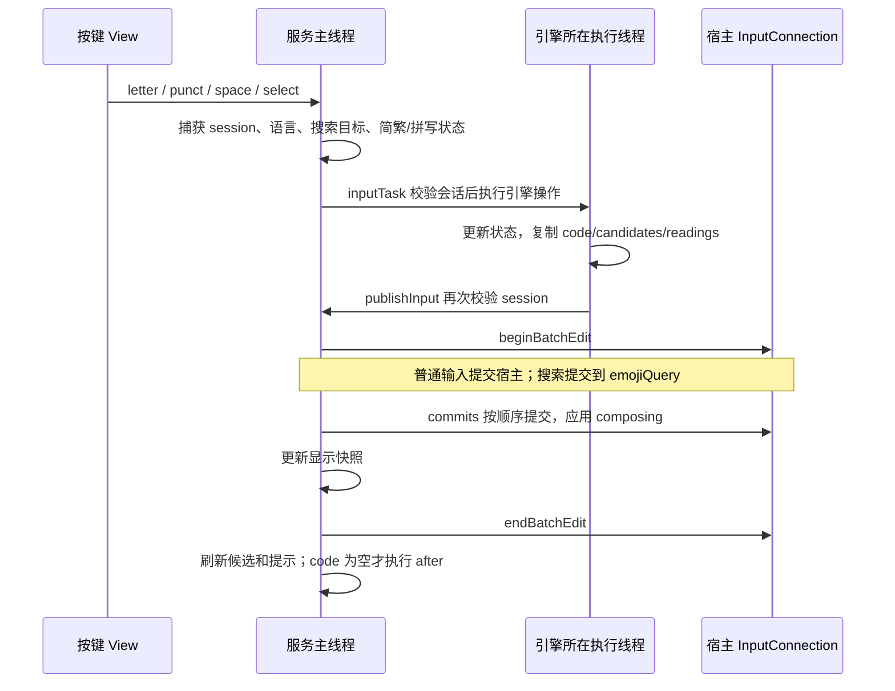

# 输入链路与引擎

基线见 [入口](README.md)。核心实现是 [`FansonInputMethodService.kt`](../../app/src/main/java/com/fanson/ime/ime/FansonInputMethodService.kt) 与 [`WubiEngine.kt`](../../app/src/main/java/com/fanson/ime/engine/WubiEngine.kt) 中的公共引擎契约。

## 引擎契约与状态

| 类型 | 含义 | 维护约束 |
| --- | --- | --- |
| `Candidate(text, code, exact, reading, custom, sourceText)` | 可提交文字、来源编码、精确标志、读音、自定义来源、转换前文字 | 上屏只用 `text`；编码和读音只用于显示、选择及规则判断 |
| `EngineResult(commits, hint, composing, selections)` | 依次提交的字符串、提示、composing 和五笔选词来源元数据 | `composing=null` 表示本次不更新 composing；空字符串与 `null` 含义不同 |
| `InputEngine.code` | 当前临时输入 | 五笔是字母编码，英文是原始单词，韩语是当前字母/音节，不要统一假设为拉丁字母 |
| `InputEngine.candidates` | 引擎当前候选列表 | 服务复制快照供 UI 使用；韩语始终为空 |
| `backspace(): Boolean` | 引擎是否消费了一次退格 | `true` 时不删宿主正文；`false` 才交给搜索字符串或宿主删除 |
| `resolve()` | 在切换动作前确认当前输入 | 不凭空添加空格；五笔无匹配时保留编码 |
| `reset()` | 丢弃引擎临时状态 | 不等于提交正文；也不直接调用宿主 `finishComposingText()` |

五笔和英文均维护 `code/candidates`，五笔额外维护 `showingReadings`。韩语维护一个 `Syllable(initial, vowel, final)` 与当前音节的回退栈。Android 编辑器不是引擎依赖；引擎返回值由服务解释。

## 普通按键到上屏



`enqueue()` 是普通操作入口；`deleteKey()` 与 `enter()` 有各自的结果应用分支，修改统一提交逻辑时必须一起检查。五笔使用 worker；英文、韩语的 `inputTask()` 和 `publishInput()` 都同步执行。`commitText()` 自身也使用批编辑，可能嵌套于 `editorBatch()`。

`resolveThen(action)` 等价于 `enqueue({ it.resolve() }, action)`。服务用“操作后的 `code` 是否为空”判断是否继续打开面板、切语言、打开设置或光标控制；不是只看是否产生提交结果。

0.3.3 另为 `enqueue()` 增加可选 `onCommitted` 通知：非搜索、存在 commits、全部 `commitText()` 返回 true 且 code 为空时调用。0.3.3 用于符号网格自动返回，0.4.2 同版本修订另外用于中文成对引号提交后的光标定位。原 after 的条件保持；提交循环仍逐项执行，不使用会短路后续提交的 `all()`。这只增加完成通知，不补足提交失败后的引擎回滚/重放。

0.3.2 的地球短按和长按菜单选择其他语言均复用 `chooseLanguage()`，只在 resolve 成功后的回调中保存当前语言和非英语回切目标；无匹配五笔不会更改这些偏好。`LanguagePreferences` 只计算目标及管理设置，不处理引擎或宿主编辑。五笔 Shift 保留原“提交编码再进入英文大写”的行为，同时记录五笔回切目标。

## 会话、顺序和过期结果

服务在任务入队前记录 `session.get()`，在引擎操作前及主线程应用结果前分别比较令牌。会话失效后，尚未执行的旧操作跳过，已计算出的旧发布结果也跳过。五笔 reset 排在同一 worker 队列，后续新会话操作在其后执行。

同一会话的五笔操作遵循 worker FIFO，主线程按投递顺序接收结果。这里没有额外的“每次查询递增序号”，也不是只保留最新按键结果：中间结果可能包含四码或第五码的正文提交，直接丢弃会丢字。

候选按钮捕获 `Candidate`。实际选词时在**当前引擎候选**中按 `text + code` 重新找索引，找不到提示“候选已更新，请重新选择”；不直接拿旧 UI 的整数索引上屏。`CandidateStrip.revision` 仅保护候选布局的延迟溢出回调，不是引擎查询版本。

宿主连接为空时提交返回 `false`，但普通引擎状态已经前进，目前没有提交失败后的回滚或重放协议，见 [待改进事项](KNOWN_GAPS.md)。

## 五笔状态机

[`WubiEngine`](../../app/src/main/java/com/fanson/ime/engine/WubiEngine.kt) 仅把 `a..y` 的 1～4 码传给 `Lexicon.lookup()`。

| 事件/条件 | 状态与输出 |
| --- | --- |
| 输入普通字母且编码不足 4 位 | 追加编码并刷新候选；无匹配保留编码 |
| 第 4 码后，精确候选恰好一个且 `autoCommitUnique=true` | 提交该精确候选并 reset；补全候选不参与唯一计数；读音模式暂停此规则 |
| 已有 4 码再按普通字母 | `commitOnFifth=true`、有候选且非读音模式时提交第一项，再用新字母开始编码；否则保留编码并提示 |
| 空编码按空格 | 提交一个半角空格 |
| 有候选按空格/`resolve()` | 提交第一项并 reset；`resolve()` 在空编码时不加空格 |
| 无候选按空格/`resolve()` | 保留编码，提示依据当前回车策略生成 |
| 按标点或数字 | 先 resolve；成功清码后追加标点/数字，无候选时也不会先插入标点 |
| 退格 | 先删一个编码字母并刷新；空码时返回 false |

五笔回车是三种可配置行为：`commit_code` 提交原始字母；`clear_code` 只清码；`first_candidate` 提交第一项，无匹配保留编码。只要按下回车前有编码，本次就不执行换行/发送；下一次空码回车才走宿主动作。

`z` 是独立分支：空码时进入待处理原始 `z`，不查 SQL；有候选时切换读音；有编码无候选时仅提示。读音状态在继续补码和非空退格时保留，在 reset 或退格清空后结束。读音期间同时暂停四码唯一与第五码自动提交，主动选词、空格、标点和回车仍遵循相应规则。

候选刷新顺序为：原码查询与可选有效学习来源补回 → 可选简繁转换 → 可选五笔衰减分层排序 → 可选读音标注。因此繁体一简多繁会改变精确候选数量，影响四码唯一判断；所有提交路径使用转换后的候选。`reading` 永远不参与提交。

`PhraseEncoder` 支持两字各取前两码、三字取前两字首码和第三字前两码、四字以上取前三字与末字首码。传入必须是每字完整码（2～4 位）；它目前只有算法与测试，设置页要求手工填写编码，没有自动取码生成入口。

## 五笔学习反馈（0.4.0）

每个真正候选提交附 `WubiSelection(commitIndex,inputCode,candidate)`；第五码在清除旧码前捕获来源，四码唯一同样附来源，空格/resolve/回车首选复用 select。原始编码、空格和附加标点无学习元数据。

服务在入队时捕获 FrequencyPermit（五笔、开关、隐私、搜索及清空 epoch），在原 session 校验之后执行提交。enqueue 和独立 enter 均逐项检查 commitText 返回值，索引和文字与元数据吻合、资格有效且 epoch 未变才更新内存；不重新读取最终 code 推断旧选择，不因反馈重排已经发布的候选。删除刷新也应用当前学习资格。

模型、索引、容量、保存中的 revision 和清除 epoch 不归输入会话所有，属于进程共享词频组件；临时编码和结果仍遵循原会话隔离。日常保存仅 onWindowHidden 触发，不改变输入线程或添加周期任务。详见 [五笔词频维护说明](WUBI_FREQUENCY.md)。

## 英文前缀补全

[`EnglishLexicon`](../../app/src/main/java/com/fanson/ime/engine/EnglishEngine.kt) 保存词频排名与字典序词表。按小写前缀二分确定 `[prefix, prefix + '{')` 范围，完整同名词优先，其他按原词频顺序，最多 80 项；输出大小写跟随全大写或首字母大写形式。匹配区间仍会在内存排序，并非预先存好每个前缀的前 80 项。

`EnglishEngine.enabled=true` 时接收 ASCII 字母和词内首个 ASCII 撇号，更新 `code` 并返回 `composing=code`。超过 64 字母前会先确认前一段，再开始新的预编辑段。关闭补全时逐字返回提交结果，不保留单词状态；服务在关闭开关前先 resolve，密码框强制关闭。

- 点击候选提交选中词，`commitText()` 替换当前宿主 composing 区域。
- 空格提交原词再提交空格；标点先提交原词再提交标点，不自动用首候选纠正拼写。
- 回车有词时先确认原词，本次不发送/换行；空码回车走宿主动作。
- 退格优先修改预编辑词；删至空时服务设置空 composing 并结束 composing。

0.4.2 新增独立句首大写状态、宿主位置预测和常用缩写候选。缺撇号仅完整命中时按“缩写、原词、原补全”排序，去重后最多 80；原词提交规则保持。英语 L 长按撇号可继续同一个预编辑词。关闭补全不关闭句首大写。三状态、位置回调核对、字段与性能边界见 [英语维护说明](ENGLISH_INPUT.md)。

## 韩语两式组字

[`KoreanEngine`](../../app/src/main/java/com/fanson/ime/engine/KoreanEngine.kt) 把 QWERTY 位置映射为韩文字母；7 个 Shift 特例为 Q/W/E/R/T/O/P，其他大写键仍映射普通字母。服务负责一次 Shift 输入后复原。

现代音节使用 `U+AC00 + (initial * 21 + vowel) * 28 + final` 组合，`initial/vowel=-1` 表示未具备该部分，`final=0` 表示无收音。独立字母使用兼容字母显示。状态机处理复合元音、复合收音与后续元音迁移，例如：

```text
r → ㄱ；rk → 가；rks → 간；rksk → 已提交 가 + composing 나
ekfr → 닭；ekfrk → 已提交 달 + composing 가
```

每次结果可以同时包含已完成的前缀 `commits` 与下一个音节 `composing`。服务把两者放在同一个外层批编辑中，避免中间光标回调误认为用户移动了光标。

历史栈只记录当前音节的实际按键状态；在音节边界清空，因此退格不会重新打开已确认的前一个音节。复合字母逐键回退，但 Shift 一次直接输入的字母不会虚构出未按过的中间状态。

韩语没有候选，空格/标点/语言与面板切换先确认音节。回车即使有音节，也在本次确认后继续换行或执行编辑器动作，与五笔、英文不同。

## 光标、回车与删除

0.4.2 的 `onUpdateSelection()` 对英语使用预测位置和零字符实时位置核对，真实光标/选区变化时清当前词并重算句首大写；自身及过期编辑回调不会重置取消状态。韩语仍仅在 `currentCode` 非空时执行预编辑位置检查。当新选区不位于 composing 末尾时，用 `getSurroundingText(0,0,0)` 核对当前真实光标；能确认回调过期则忽略。真实光标/选区变化时结束 composing、递增会话、清空英文和韩语引擎及候选，后续输入不替换旧位置。

这个零长度查询用于取得位置，不读取正文。退格是另一条链路，会读取光标前最多 512 个 UTF-16 单元；不要把两者混成“从不读取周边文字”。五笔目前没有同样的光标变更清码分支。

空码回车和韩语回车按 `IME_MASK_ACTION` 取宿主动作；设置 `IME_FLAG_NO_ENTER_ACTION` 或动作为 NONE/UNSPECIFIED 时提交换行，其余调用 `performEditorAction()`。搜索模式回车只更新内部搜索，不触发宿主动作。

宿主退格依次处理：

1. 若有选区，提交空字符串替换选区。
2. 读取光标前最多 512 单元；为空时发送 DEL 按键事件。
3. 用 Android ICU `BreakIterator` 找最后一个字符簇，同时从内置 emoji 中找最长后缀匹配。
4. 取两者较大的 UTF-16 长度，调用 `deleteSurroundingText(count,0)`。

内部搜索字符串退格使用 ICU 字符簇边界。已提交韩文按完整字符删除；编码/音节退格则先由引擎消费。新增 emoji、扩展区汉字或删除优化时，必须保留代理对、肤色、旗帜、变体选择符和 ZWJ 的完整性验证。

0.4.2 同版本长按修订仍走原 punct/enqueue：顶部数字行 PC 符号与冒号/双引号映射由 KeyboardShortcuts 决定。仅中文成对引号成功正文提交后，经 onCommitted 调用 PairedQuoteCursor；最多读光标前 1 个字符核对右引号与绝对下标后 setSelection。无匹配、失败、搜索和过期会话不移动宿主光标。详见 [长按维护](KEYBOARD_SHORTCUTS.md)。
